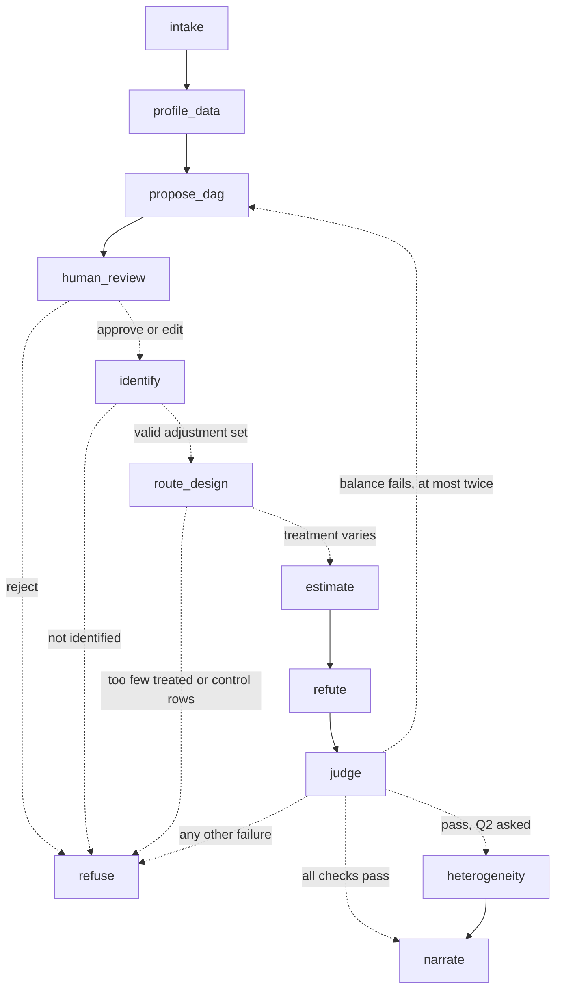

# CausalLab AI

**How much of the extra clicking on top search results is caused by the position itself, and how much by the ranker putting better hotels on top?**

CausalLab AI is a LangGraph agent, using Claude, that takes a causal question in plain language, proposes the causal assumptions, asks a person to approve them, runs five estimators, tries to break its own answer, and then reports a result or declines to give one. It is tested on Expedia's 2012–13 hotel-search data, where about 30% of searches were ranked at random. That gives a randomised benchmark for the same effect the agent estimates from algorithm-ranked searches: a within-study comparison in the style of LaLonde (1986).

The full specification is in [`SPEC.md`](SPEC.md). The reference specification, fixed before the benchmark was computed, is in [`config/spec_locked.yaml`](config/spec_locked.yaml). Everything changed after that is listed under [What was fixed in advance, and what was not](#what-was-fixed-in-advance-and-what-was-not).

## Findings in brief

1. **Adjustment removes most of the bias, but whether it removes all of it depends on the comparison group.** Against positions 4–10 (the pre-registered comparison), the doubly robust estimate is 6.61 pp against an experimental 5.25 pp: a *mismatch*. Against every position from 4 down (the spec's sensitivity check), the doubly robust, weighting and double machine learning estimates all land within half a point of the experiment: a *match*. A "match" means the whole gap interval lies within ±20% of the benchmark, not that the gap is zero: AIPW's gap there is −0.27 pp [−0.46, −0.08], small but statistically different from zero.
2. **Part of the main gap comes from comparing different hotels, not only from confounding.** The ranker fills the top ten with different hotels than random ranking does, and the effect differs by hotel. On synthetic data with a known answer, this alone produced a large false "mismatch". Two post-hoc comparisons that put both estimates on the same hotels put the hotel-mix share of the 1.36 pp gap at roughly a quarter to a half, so the rest is leftover confounding or selection bias in the benchmark itself, in a proportion these data do not pin down.
3. **The agent behaved correctly on known-answer tests, though the tests are easier than real data.** In 50 synthetic trap runs it did the right thing every time, but code, not Claude, makes the refusal decisions, and the offline version with fixed answers also scores 50/50. What tests Claude's own judgement is narrower: in the 30 clean, collider and mediator runs it chose a valid adjustment set every time and never adjusted for the collider or mediator (0 of 20). The variable descriptions it reads state when each variable was recorded, which makes those traps easier to spot than in real data. On the real data, Claude proposed exactly the reference adjustment set for Q1.
4. **The promotion badge (Q3) may raise clicks, by about 1.4 pp,** but the badge was not randomised, so this is *suggestive, not experimentally verified*, and its placebo check is not fully clean. The booking effect (0.25 pp) is small and fragile.

## Results (sample of 5 million rows)

All numbers come from a 50.5% sample of searches (about 5 million rows; 140,424 algorithm-ranked searches with 1,218,303 rows in positions 1–10, and 61,386 randomly ranked searches). Intervals are 95% and clustered by search. Final runs: Q1 `run-ff2df23c`, Q3 clicks `run-76e19564`, Q3 bookings `run-87f4e454`. Every top-level result file and every run summary (`summary.json`) records the code version that made it (`code_version`), and all of them were made by the same code, `5b82799dae8b`; each run's estimate and check files sit beside its summary and were written in the same run. The saved results behind every number here are in [`results/`](results/): the summary JSON files, the three final runs (report, estimates, checks and the step-by-step trace), both trap-suite summaries, and `post_hoc_checks.json`, which holds three post-hoc figures (6.84, 7.11 and 5.37 pp below) computed by `scripts/post_hoc_checks.py` from the saved reference models and data. `python -m causallab table --run-id <id>` rebuilds the Q1 tables from those files.

### Q1: effect of a top-3 position on clicks

Treated: positions 1–3. Control: positions 4 and 6–10 (5 is a reserved slot). Tolerance for a "match": the whole gap interval within ±20% of the benchmark (±1.05 pp here). This is a practical-equivalence rule, not a test of zero difference: a gap can be statistically non-zero and still count as a match. The benchmark reweighted so its searches resemble the algorithm-ranked ones (spec §4.4) is also 5.25 pp [5.08, 5.43], so differences in the kind of search between the two arms do not move it.

| Estimate | Effect (pp) | 95% interval | Gap to benchmark (pp) |
|---|---|---|---|
| Experimental benchmark (randomly ranked searches) | 5.25 | [5.09, 5.42] | |
| Naive difference, algorithm-ranked searches | 9.77 | [9.64, 9.89] | 4.52 [4.31, 4.72] mismatch |
| Regression adjustment | 8.04 | [7.92, 8.17] | 2.80 [2.59, 3.00] mismatch |
| Inverse propensity weighting | 6.96 | [6.83, 7.09] | 1.71 [1.50, 1.92] mismatch |
| **Doubly robust (AIPW), primary** | **6.61** | **[6.49, 6.73]** | **1.36 [1.16, 1.57] mismatch** |
| Double machine learning | 6.53 | [6.40, 6.65] | 1.28 [1.07, 1.49] mismatch |

Adjustment removes about 70% of the naive gap. Claude proposed exactly the reference adjustment set (44 variables) and excluded position (it defines the treatment), `booking_bool` and `gross_bookings_usd` (both recorded after the click).

**Refutation checks (all pass).** Code applies every rule; the thresholds are in `config.yaml`.

| Check | Result | Rule |
|---|---|---|
| Overlap | 0% of rows trimmed | at most 30% outside [0.01, 0.99] |
| Balance | largest weighted SMD 0.024 | every SMD below 0.1 |
| Placebo | 0.00 pp [−0.11, 0.10] | average of 5 permuted-treatment estimates within ±1.96 single-run SEs of zero |
| Random common cause | estimate moves 0.02 SE | under 0.5 SE |
| Subset stability | 95% of 20 half-samples inside the interval | at least 80% |
| Sensitivity | regression estimate 8.04 pp would fall to 7.69 pp (cluster-robust interval 7.57–7.81) with a hidden confounder as strong as `n_results`; robustness value 0.121; E-value 3.39 | effect keeps its sign |
| Held-out covariate (reported only) | top-3 hotels sit 0.255 SD higher on `prop_location_score2` after adjusting for everything else | not pass or fail |

The sensitivity row benchmarks one covariate at a time, and related columns (a score and its page-relative version) share the work, so the strongest single one, `n_results`, is weak (partial R² 0.007 with the treatment). Benchmarked against groups instead (post-hoc, same regression), the regression estimate of 8.04 pp would fall to 7.11 pp with a hidden confounder as strong as the three location-score-2 columns together, and to 5.37 pp with one as strong as all 23 hotel, price, page-relative, query and distance columns together (the list is in `scripts/post_hoc_checks.py`; results in `results/post_hoc_checks.json`). The effect keeps its sign in every case.

None of these checks can see confounding by information the file does not contain, which is the main threat here: the ranker's own score, built from things like a hotel's past click and booking rates.

### Sensitivity check from the spec: every position from 4 down as the control group

Same specification, estimators, trimming and gap test; 3,484,552 rows; 0.6% trimmed; tolerance ±1.52 pp.

| Estimate | Effect (pp) | 95% interval | Gap to benchmark (pp) |
|---|---|---|---|
| Experimental benchmark | 7.59 | [7.45, 7.74] | |
| Naive | 12.94 | [12.84, 13.04] | 5.34 [5.16, 5.52] mismatch |
| Regression adjustment | 10.23 | [10.12, 10.34] | 2.63 [2.45, 2.82] mismatch |
| Inverse propensity weighting | 7.91 | [7.77, 8.05] | 0.32 [0.11, 0.52] match |
| **Doubly robust (AIPW)** | **7.33** | **[7.20, 7.45]** | **−0.27 [−0.46, −0.08] match** |
| Double machine learning | 8.05 | [7.94, 8.16] | 0.46 [0.27, 0.64] match |

The effects are larger because the control positions now reach much further down the page, where clicks are rarer. The verdict flips for the three machine-learning estimators, while naive and regression still miss badly. A likely reason: a whole results page holds nearly the same hotels whichever way it was ranked, so this window compares like with like, while positions 1–10 hold the ranker's chosen hotels in one arm and a random draw in the other. On the synthetic data the same pattern appears (doubly robust 7.9 against a benchmark of 8.0). AIPW now sits slightly *below* the benchmark; its interval excludes zero.

This check was in the spec from the start, but it was implemented and run only after the primary results were known.

### Post-hoc: putting both estimates on the same hotels

Added after a synthetic check showed that the plain comparison mixes confounding with a difference in hotels. Not part of the pre-registered comparison.

| Comparison | Estimate (pp) | Gap (pp) | Verdict |
|---|---|---|---|
| Ranker's hotels: experimental benchmark reweighted to resemble them, against the primary estimate | 5.89 [5.68, 6.12] | 0.72 [0.46, 0.98] | match |
| Randomly ranked hotels: observational effect carried over to them, against the plain benchmark | 6.49 | 1.24 [1.07, 1.39] | mismatch |
| The same outcome models on the ranker's own hotels (for a like-for-like comparison with the row above) | 6.84 | | |

How far to trust each, from the synthetic check, where the true effect is known (about 8.8 pp on the ranker's top-ten rows and 6.3 pp on the randomly ranked ones):

- **Carried-over estimate:** recovered the truth closely (about 6.5 against 6.3). Its interval covers only sampling in the randomly ranked arm, not the outcome models' own uncertainty, so it is too narrow.
- **Reweighted benchmark:** moved only about 57% of the way from the plain benchmark to the truth, so its gap runs too large. Whether a hotel makes the ranker's top ten depends on how it compares with the other hotels in the same search, which hotel-level weights cannot fully capture. Its largest weight is 20 and its effective sample 58%, and its interval ignores the uncertainty in the weights. It is the weakest of the comparisons.

Compared like for like, the two put the hotel-mix share at roughly a quarter to a half. The carried-over figure is a plain outcome-model prediction, so it should be set against the same models' prediction on the ranker's own hotels (6.84 pp), not against AIPW: the hotel mix then accounts for about 0.35 pp, roughly a quarter of the 1.36 pp gap (`post_hoc_checks.json`). The reweighted benchmark puts it at about 0.64 pp, roughly half, and it is the weaker of the two. Both intervals leave out a source of uncertainty (the outcome models, the weights). Together with the all-positions result, the fair conclusion is that the main mismatch is partly a population effect and partly leftover confounding or selection bias in the benchmark, in proportions these data do not pin down.

### Q2: does the effect differ by segment? (causal forest against experimental group effects)

`CausalForestDML` on 1.2 million rows of the algorithm-ranked arm, against the difference in means in the randomly ranked arm for the same groups.

| Group | Forest (pp) | Experiment (pp) |
|---|---|---|
| Price tercile 1 (cheapest) | 7.88 | 6.18 |
| Price tercile 2 | 6.70 | 4.98 |
| Price tercile 3 | 5.08 | 4.45 |
| Stars 1–2 | 7.00 | 5.29 |
| Stars 3 | 6.91 | 5.00 |
| Stars 4 | 6.43 | 5.66 |
| Stars 5 | 4.78 | 4.29 |
| Unrated | 7.77 | 7.18 |
| Family | 6.93 | 5.44 |
| Other | 6.42 | 5.01 |
| Solo | 6.11 | 5.46 |
| Weekend couple | 6.69 | 5.29 |

- The forest sits above the experiment in all 12 groups (by 1.2 pp on average), as the Q1 estimate sits above the Q1 benchmark. The intervals overlap in 5 of 12 groups, but that count understates the agreement: the forest intervals are not clustered by search, so they are too narrow. Clustering them would raise the overlap count; it would not remove the upward shift.
- It gets price right: the effect falls as price rises in both. Both put five-star hotels lowest among rated hotels and unrated hotels highest.
- It gets the middle star bands and trip types wrong: the experiment shows no steady fall from 1–2 to 4 stars, and its trip-type differences are small (5.0 to 5.5 pp) and do not follow the forest's order.

### Q3: does the promotion badge cause more clicks and bookings?

Estimated inside randomly ranked searches, so position is not a confounder. The badge itself was not randomised (hotels and Expedia decide it), so there is no benchmark and the verdict is capped at *suggestive, not experimentally verified*.

| | Clicks (`run-76e19564`) | Bookings (`run-87f4e454`) |
|---|---|---|
| Naive | 1.67 pp | 0.18 pp |
| Regression / IPW / DML | 1.46 / 1.39 / 1.35 pp | 0.23 / 0.26 / 0.25 pp |
| **Doubly robust (AIPW), primary** | **1.35 pp [1.25, 1.45]** | **0.25 pp [0.21, 0.29]** |
| Checks | all pass; subset stability 95% | all pass; subset stability 85% |
| Robustness value / E-value | 0.027 / 1.94 | 0.012 / 2.39 |

- In both runs Claude excluded displayed price (`log_price`) and the four features built from it (`price_rank_pct`, `price_rel_median` and the two competitor-price counts), because the promotion lowers the price, so price is part of the badge's effect rather than a confounder. It also excluded the four page-relative quality columns (`star_rel`, `review_rel`, `loc1_rel`, `loc2_rel`) as redundant with the levels, and for bookings `click_bool` (a booking requires a click). It added `position` to both as a precision variable (random in this arm).
- For clicks only, it also left out the query affinity score and the three visitor-history columns, saying they predict clicks but not the badge. The data does not support that reason: in the randomly ranked arm promoted hotels score higher on both (SMD 0.14 for the affinity score and 0.11 for visitor star history, among the roughly 4% and 3% of rows where they are recorded), and for bookings Claude kept the same affinity score as a confounder. The practical effect is small: an earlier Claude run for the same question (`run-4b066e36`, not published) kept these columns and the page-relative ones (39 variables against 30) and gave 1.37 pp against 1.35. It does show that Claude's proposal for Q3 can change from run to run on borderline variables. For Q1 it proposed the same 44 reference variables in all three runs checked.
- The offline run (`q3 --no-llm`) reuses the Q1 adjustment set, which includes displayed price, and gives 0.73 pp for clicks. The two sets differ in more than price, so not all of that drop comes from adjusting for the mediator, but it shows that the choice of adjustment set matters a lot for this question.
- Both robustness values are small: a hidden confounder explaining about 1–3% of the remaining variation in both the badge and the outcome would be enough to erase the effects. The booking result passed subset stability only under the recalibrated threshold (see below).
- Bookings were sampled differently in the two arms of the file (94% of algorithm-ranked searches contain a booking, against 13% of randomly ranked ones), so the booking result is secondary.
- Under the original, pre-registered refuter rules both Q3 questions were refused (clicks by a single-permutation placebo, bookings by subset stability at 85%). Both now pass only because of the recalibration described below, so read them with that in mind.
- **The clicks placebo is not clean.** All five permuted-treatment estimates came out negative, averaging −0.05 pp. The placebo rule passes it, but a proper test of that average fails (z ≈ −2.4; see the placebo row below). The size is small next to the 1.35 pp estimate, but it points to a small bias in the pipeline for this treatment.

### Trap suite: does the agent make the right call when the answer is known?

Five synthetic scenarios, ten seeds each, 20,000 rows per run. `traps` uses Claude for its steps; `traps --no-llm` swaps in fixed reference answers and so tests the checks, not the judgement. Read the two columns together:

- **What tests Claude:** clean confounding, collider and mediator. Claude must pick the adjustment set; the collider and mediator must be left out. The variable descriptions say when each was recorded ("after the session ended", "during the session"), which makes them easier to spot than in real data.
- **What tests the code around Claude:** no overlap is refused by the overlap rule, and in failing balance the judge step forces the re-specification (Claude proposes what to change; code decides that it must, and refuses when it still fails). Failing balance most likely fails because the propensity model (at least 200 rows per leaf, about 2,400 rows per fold) is too coarse for this scenario; a simpler model might balance it.

| Scenario | Expected behaviour | Claude | Offline |
|---|---|---|---|
| Clean confounding | proceed and recover the effect | 10/10 | 10/10 |
| No overlap | refuse | 10/10 | 10/10 |
| Collider (`support_ticket_opened`) | exclude it and proceed | 10/10 | 10/10 |
| Mediator (`detail_page_seconds`) | exclude it and proceed | 10/10 | 10/10 |
| Failing balance | re-specify, then refuse | 10/10 (all re-specified) | 10/10 |

29 of the 30 reported Claude runs have the true effect inside their 95% interval; one miss in 30 is what a 95% interval should give. Claude adjusted for the collider or mediator in 0 of 20 runs here; the same held in the suites run during development, whose results are not published.

## What was fixed in advance, and what was not

The reference specification (`config/spec_locked.yaml`) was written and saved before the benchmark module ran. The project was not under version control until it was finished, so there is no commit history that proves this order; the evidence is the file's own record of its decisions and the build log. The changes below were made afterwards. Each is labelled where it appears, and the evidence behind it is given here so you can judge it.

| Change | From → to | Why, and on what evidence |
|---|---|---|
| Sample size | 10% → 50.5% of searches (about 5 million rows) | More precision. Verdicts at 10% were the same as at 5M for Q1. |
| Placebo design | shuffle top-3 within each search (the spec) → shuffle across the whole sample | Shuffling within a search leaks part of the true effect when searches differ in how many treated rows they have, so a correct pipeline would fail the placebo. Decided during the build, before the benchmark. |
| Placebo test | one permutation → average of 5 | A single permutation fails by chance 5% of the time by design. In the trap suite it refused a correct clean run on one seed every time, and it refused Q3 clicks. **This over-corrects.** The average of five is still judged against a *single-run* standard error, so it is held to about 4.4 of its own standard errors (1.96 × √5): the rule now flags only a systematic placebo effect larger than about two single-run standard errors, and is not a 5% test. Testing the average against its own standard error instead, Q1 (z = −0.06) and Q3 bookings (z = −0.9) still pass, and Q3 clicks fails (z = −2.4). |
| Subset-stability threshold | 90% → 80% of half-samples inside the full interval | If each half-sample fell outside the full-sample 95% interval 5% of the time, independently, the 90% rule would refuse about 7.5% of correct runs. In practice it refused far more: two trap suites at 90% refused 5 of 30 correct runs, and 12 of 30 passed with no margin. The likeliest reason is extra noise from the half-samples' own 2-fold refits, which the 5% figure leaves out. |
| Q2 forest size | 200,000 → 1.2 million rows | Narrower group intervals. |
| Population-matched comparisons | new | The synthetic check: the plain comparison produced a large false mismatch when effects differ by hotel. |
| Sensitivity interval | adds a cluster-robust interval for the adjusted estimate | The bound and robustness value stay classical: clustering them raised the robustness value (0.21 → 0.37 in a test), which would flatter the result. |
| Group sensitivity benchmarks | new, reported beside the pre-registered check | One covariate at a time understates a hidden confounder's plausible strength when related columns share the work. Added after an external review and computed on the same regression by `scripts/post_hoc_checks.py` (saved in `results/post_hoc_checks.json`); not part of the pipeline's pass rule. |
| Held-out covariate | now also leaves out the columns computed from it (`loc2_missing`, `loc2_rel`) | Keeping them left the held-out value in the model; the reported imbalance rose from 0.128 to 0.255 SD. Reported only. |
| Reproducibility | deterministic LightGBM; features rounded to 9 decimals | DuckDB sums its within-search averages in parallel, so two builds differed in the 16th decimal and LightGBM could split on it. Reruns now repeat to the last printed digit on the same machine. |
| All-positions window | implemented late | In the spec from the start; run after the primary results were known. |

**Before and after.** Under the original rules, the same 5-million-row run gave identical Q1 numbers, but the Claude trap suite scored 45 of 50 and both Q3 questions were refused. All five trap misses were false refusals of correct runs: two clean runs by the single-permutation placebo, and three collider runs by subset stability at 85%, 85% and 80%. Claude's decisions were right in every one; the difference came entirely from the checks' false-alarm rates. Those results are kept outside the repository, in `_archive/baseline_original_rules_2026-11-20`.

**A finding about the data.** In the randomly ranked arm, where position was random, top-3 hotels still score higher on `prop_location_score2` (SMD 0.123) and, less strongly, `srch_query_affinity_score` (0.076). There are two explanations, and the data supports the first for about half of the imbalance. (1) *Selection on clicks*: the file keeps only searches with at least one click, and in a randomly ordered search a click is more likely when good hotels happen to land on top, so the kept searches have better hotels on top. In searches that also had a click below position 10, which would be in the file whatever sat on top, the location-score imbalance halves (0.062, against 0.156 in searches without one). (2) *Click-log leakage*: Expedia may have computed these scores partly from clicks that include these searches; this is not proven, and other selection could explain the rest. Notebook 02 shows the split. An exploratory run that drops both scores (and the columns built from them) *widens* the gap: AIPW 8.20 pp [8.08, 8.33], against 6.61 with them and a benchmark of 5.25. Their net effect is to pull the estimate towards the benchmark, but that mixes confounding removed with any bias that leakage or selection adds, so it does not show that they are clean confounders. Reproduce it (exploratory, offline) with `python -m causallab run --no-llm --auto-approve --exploratory-drop prop_location_score2,loc2_missing,loc2_rel,srch_query_affinity_score,affinity_missing`.

**Disclosure.** The Phase 1 EDA printed click rates by position for both arms during the build, before the benchmark module ran. The reference specification follows from row counts and the spec, not from those rates (see `config/spec_locked.yaml`).

## How it works



- **Claude never computes or copies a number.** Estimates travel in typed state (Pydantic). Claude writes prose with placeholders such as `{primary_estimate}`; code fills them, and a guard fails the report if any number in it was not written by code. If Claude's prose contains a digit it is rejected and a code-written template is used instead (this happened in development runs, and is logged in the trace). A placeholder name written without its braces is repaired, not rejected.
- **Human approval sits on assumptions, not results.** The run pauses before any estimate exists (a LangGraph interrupt with a SQLite checkpointer). The reviewer can approve, reject, or replace the adjustment set.
- **Code makes every pass or fail decision**, using thresholds in `config.yaml`. Claude explains decisions; it does not make them.
- **The firewall.** Each arm has its own loader. A top-3 question can only read algorithm-ranked searches; only `benchmark.py` reads the randomly ranked arm, and a test checks the access log.
- **Identification is checked twice:** DoWhy's back-door test, plus a check that no adjustment variable descends from the treatment, because DoWhy's test alone accepts a mediator. Variables Claude marks as part of the design (position, which defines the treatment) are merged into the treatment node.
- **Re-specification never drops an approved confounder.** It may only add covariates or interactions, or tighten trimming.
- **Offline mode** (`--no-llm`) swaps the Claude nodes for fixed answers built from the reference graph, so everything runs without an API key.

Models are set in `config.yaml`: Claude Sonnet 5.5 for `propose_dag` (the causal graph), Claude Haiku 5.5 for the other Claude nodes. Every node entry, exit and routing decision is logged to `results/runs/<id>/trace.jsonl`.

## Setup on Windows

1. Install **Python 3.13**. The versions in `requirements.txt` were tested with it.
2. Open PowerShell in this folder:

   ```powershell
   py -3.13 -m venv .venv          # or: <full path to python.exe> -m venv .venv
   .venv\Scripts\Activate.ps1
   python -m pip install --upgrade pip
   pip install -r requirements.txt
   pip install -e .
   ```

   If PowerShell blocks the activation script, run `Set-ExecutionPolicy -Scope CurrentUser RemoteSigned` once. If Windows Smart App Control blocks scikit-learn's DLLs, it has to be turned off.
3. Download `train.csv` from the Kaggle competition *Personalize Expedia Hotel Searches – ICDM 2013*. `config.yaml` expects it at `../expedia-personalized-sort/data/train.csv`; change `paths.raw_csv` if yours is elsewhere.
4. For Claude runs only: copy `.env.example` to `.env` and add your `ANTHROPIC_API_KEY`. Every `--no-llm` run, and every step that does not involve the agent, needs no key.

Keep the project outside OneDrive-synced folders: syncing the Parquet files slows everything down.

## Running it

Times are from the 5-million-row run on a laptop (Intel Core Ultra 7, 32 GB RAM).

| Step | Command | Time |
|---|---|---|
| Tests | `python -m pytest -q` (43 tests, synthetic data) | 1–2 min |
| Data | `python -m causallab convert` (once), then `prepare`, then `eda` | a few min, then 20 s |
| Benchmark | `python -m causallab benchmark` | 20 s |
| Estimates | `python -m causallab estimate` | 3–4 min |
| Window check | `python -m causallab estimate --all-positions` | 6 min |
| Post-hoc figures | `python scripts/post_hoc_checks.py` (after `estimate`) | about 1 min |
| Refuters | `python -m causallab refute` | 9 min |
| Q1 agent run | `python -m causallab run`, approve at review, then `table --run-id <id>` | about 13 min |
| Q2 | `python -m causallab q2` | 7 min |
| Q3 | `python -m causallab q3`, approve both reviews | about 20 min |
| Trap suite | `python -m causallab traps` (Claude), `traps --no-llm` (offline); add `--fresh` to rerun instead of reusing finished runs | about 30 min, 15 min |
| Diagram | `python -m causallab diagram` | under 1 min |
| Notebooks | `python scripts/run_notebooks.py` | about 25 min |

`run` and `q3` pause at human review and print the proposed assumptions. Resume with:

```powershell
python -m causallab resume --run-id run-xxxxxxxx --decision approve
```

`--decision edit --adjust-file my_set.txt` replaces the adjustment set (one column per line; unknown columns are dropped and logged); `--decision reject` ends the run with a refusal. If a run stops on an error (for example, the API credit runs out), the same `resume` command retries it from the last checkpoint, and `traps` reuses finished runs and resumes interrupted ones (`--fresh` starts new runs under new ids).

**Which code made a result.** Every top-level result file and every run summary records `code_version`, a short hash of the package source (`src/causallab`); `post_hoc_checks.json` also records a hash of its script. `python -m causallab version` prints the current one; a file whose `code_version` differs was made by older code.

### Without the Kaggle file

```powershell
python -m causallab prepare --synthetic
python -m causallab benchmark --synthetic
python -m causallab estimate --synthetic
python -m causallab run --no-llm --synthetic --auto-approve
```

This builds an Expedia-like file with the same columns and known true effects (`results/synthetic_truth.json`). Synthetic results are written to their own `_synthetic` files and never overwrite real ones.

### Notebooks

`notebooks/01` to `07` walk through each phase with explanations, expected results and short self-check questions: EDA, benchmark, estimators, refuters, the agent, heterogeneity and the promotion badge, and the trap suite. They run on the real sample by default; set `SYNTHETIC = True` in the setup cell to use the synthetic file (build it first with `prepare --synthetic`). They read the published result files but never write over them: anything they recompute stays in the notebook, and the agent diagram goes to `results/agent_graph_notebook.mmd`. `scripts/run_notebooks.py` saves a failed run as `<name>.failed.ipynb`, so the last complete notebook is kept. `scripts/build_notebooks.py` regenerates them from scratch and overwrites any notes you have added.

## Limitations

- The ranker's internal score is unobserved, so some confounding may remain in Q1, and the share of the main gap it explains is not pinned down (see the post-hoc section).
- Hotels in one search compete for the same slots; the estimates ignore this interference.
- The file only contains searches with at least one click, so all rates are conditional on that selection, and the selection differs between the arms. In the randomly ranked arm the selection also favours searches with good hotels on top (see the finding about the data), so the benchmark itself may carry some selection bias; it is the best available reference, not a perfect one.
- Two thresholds and the placebo design were recalibrated after the first full run, on trap-suite evidence. The Q1 verdicts do not depend on that change; the Q3 verdicts do. The recalibrated placebo rule is too lenient (it is not a 5% test), and under a proper test the Q3 clicks placebo fails.
- The data is from 2012–13 and one company. The method transfers; the numbers do not.

## Future work

- Propagate the outcome models' uncertainty into the carried-over estimate (for example, by refitting inside the bootstrap), and the weights' uncertainty into the reweighted benchmark.
- Cluster the Q2 forest intervals by search.
- Replace the placebo rule with a test of the five-permutation average against its own standard error, or against a permutation null distribution, and re-run Q3 under it.

## Repository layout

```text
config.yaml                  thresholds, sample size, model IDs, seeds
config/spec_locked.yaml      reference specification, fixed before the benchmark
config/data_dictionary.yaml  variable descriptions shown to Claude
src/causallab/
  data.py                    CSV to Parquet, sampling by search, arm loaders (firewall)
  features.py                within-search features, zero and missing indicators, windows
  eda.py                     Phase 1 checks
  benchmark.py               experimental-arm benchmark (firewalled), gap test, post-hoc comparisons
  estimators.py              naive, regression, IPW, AIPW, DML
  refuters.py                overlap, balance, placebo, random common cause, subsets, sensitivity
  sensitivity_window.py      the all-positions comparison-group check
  heterogeneity.py           causal forest and group effects (Q2)
  synthetic.py               Expedia-like data and the five trap scenarios
  trap_suite.py              trap-suite runner
  results_table.py           README tables from a run's saved files
  agent/                     state, nodes, graph, prompts, report guard, datasets
  cli.py                     python -m causallab ...
results/                     saved outputs behind the README (models, checkpoints and trap runs are not published)
notebooks/                   01 to 07, teaching notebooks
scripts/                     build_notebooks.py, run_notebooks.py, post_hoc_checks.py
tests/                       pytest suite (synthetic data, no Kaggle file needed)
```

## References

- Kaggle. Personalize Expedia Hotel Searches, ICDM 2013.
- LaLonde, R. (1986). Evaluating the econometric evaluations of training programs with experimental data. *American Economic Review*.
- Ursu, R. (2018). The power of rankings: Quantifying the effect of rankings on online consumer search and purchase decisions. *Marketing Science*.
- Chernozhukov, V. et al. (2018). Double/debiased machine learning for treatment and structural parameters. *The Econometrics Journal*.
- Wager, S. & Athey, S. (2018). Estimation and inference of heterogeneous treatment effects using random forests. *JASA*.
- Cinelli, C. & Hazlett, C. (2020). Making sense of sensitivity: Extending omitted variable bias. *JRSS B*.
- VanderWeele, T. & Ding, P. (2017). Sensitivity analysis in observational research: Introducing the E-value. *Annals of Internal Medicine*.
